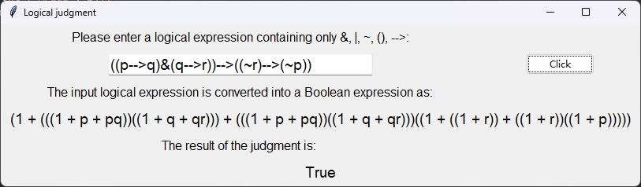

# Boole Reduction

Efficient reduction of Boolean / Algebra-of-Boole expressions over GF(2), with CLI tools, correctness tests, and a local web UI for comparing implementations.

Problem motivation: [N J Wildberger — Boole Reduction (MathFoundations 269)](https://www.youtube.com/watch?v=AJr44JgbKho&list=PLIljB45xT85CnIGIWb7tH1F_S2PyOC8rb&index=19).

## Setup

```bash
pip install -r requirements.txt
```

## Quick start

### Reduce (GF(2) — fastest, full reduced form)

```bash
python run_reduce.py --expr "(a-->b)&(b-->c)&(c-->d)"
python run_reduce.py --case syllogism
```

### Compare implementations (CLI)

Runs **boole_engine (GF(2))**, **LogicJudge.py**, **LogicJudgeUpdated.py**, and partition mode:

```bash
python run_compare.py                    # default benchmark set
python run_compare.py --list             # list example cases
python run_compare.py --case makesample_8
python run_compare.py --expr "a | ~a"
python run_compare.py --quick            # GF(2) only (fast)
```

### Local web UI

There is no hosted demo. Run the server on your machine:

```bash
python web/app.py
```

Then open **http://127.0.0.1:8000** — enter an expression or pick an example and compare timings.

### Tests

```bash
python -m unittest tests.test_boole_correctness -v
```

## Expression syntax

| Symbol | Meaning |
|--------|---------|
| `-->`  | implies |
| `\|`   | or |
| `&`    | and |
| `~`    | not |
| `()`   | grouping |

## Core modules

| File | Description |
|------|-------------|
| `src/boole_engine.py` | Primary GF(2) reduction engine (native poly arithmetic) |
| `src/LogicJudge.py` | Earlier SymPy `expand`-based reducer |
| `src/LogicJudgeUpdated.py` | Chunked/partitioned SymPy reducer |
| `src/compare_runner.py` | Shared benchmark logic for CLI + web |
| `src/BaseClass.py` | Object-oriented syllogism API |

## Optional legacy UI

```bash
python UI.py
```


